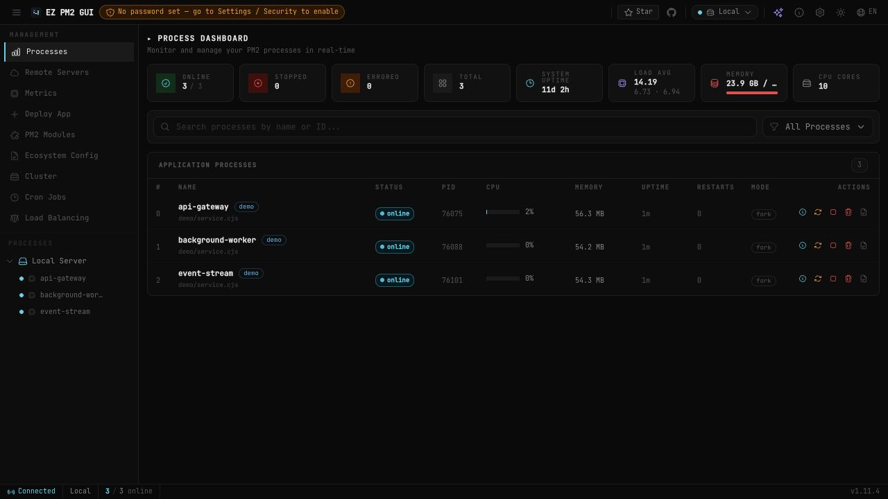
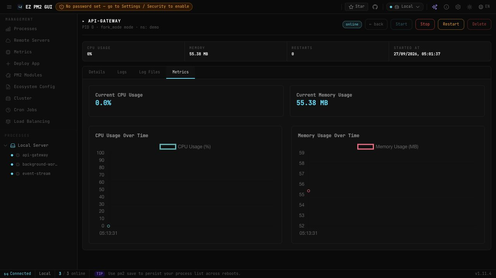
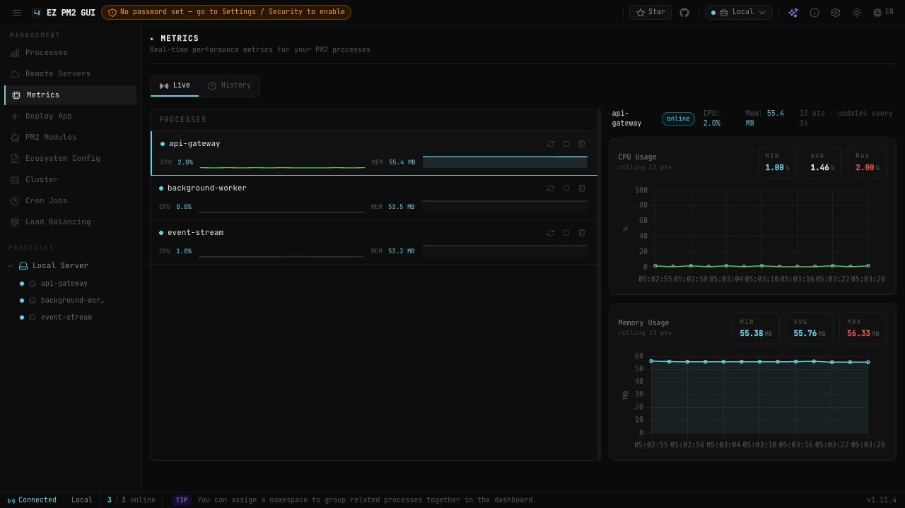
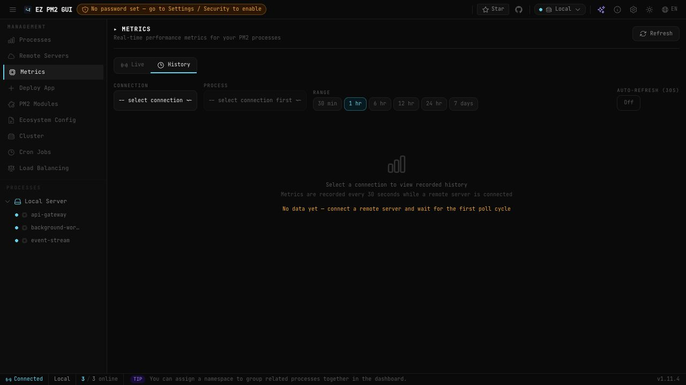
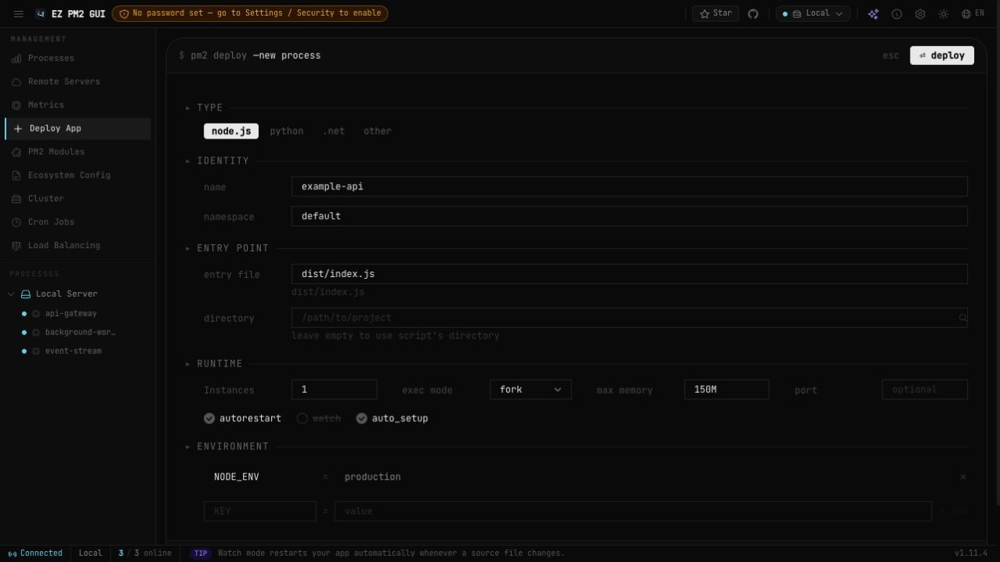
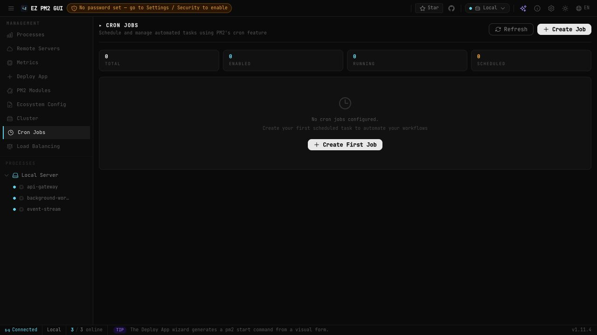
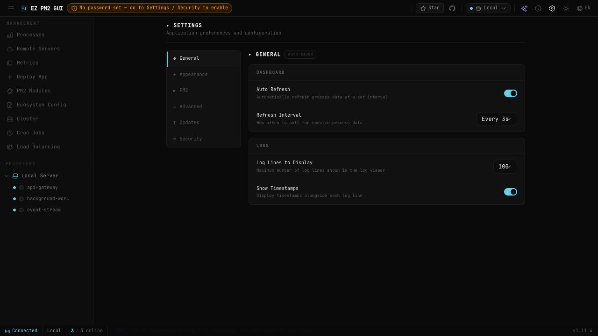

# EZ PM2 GUI

[](https://discord.gg/ttgc2zqK7b)

🌐 **Available Languages**: [English](README.md) | [中文](README_zh.md)

A modern web-based graphical user interface for the PM2 process manager, built with TypeScript, Tailwind CSS, and React.

## v1.13.0

- Investigate logs in a persistent right sidebar with separate Markdown question/response chats, suggested follow-up questions, and SQLite conversation history. Analysis keeps running when you hide the sidebar or reload the page.
- Choose Ollama local or cloud models and optional model overrides for installed Claude Code, Codex, Cursor, and GitHub Copilot CLIs. Provider discovery is cached by the backend; cloud analysis requires explicit consent.
- Reduce repeated prompt fields with a reversible TSLN log profile when the complete prompt is smaller than JSON. Read the explanation and original paper from **Help**.
- Connect disconnected servers directly from the process sidebar and see their processes immediately. Remote analysis IDs, reconnect notifications, and development WebSocket proxy routing are fixed.

Install or upgrade:

```sh
npm install -g ezpm2gui@1.13.0
```

## Demo Videos and User Guide

Open **Help** in the application sidebar, or visit `/help`, to browse and play the published demo videos.

- [Product walkthrough](https://youtu.be/u1ckawU-sg4) — a 66-second tour of process monitoring, logs, deployment, and settings with narration and soft background music.
- [Earlier AI log analysis demo](https://youtu.be/EPwORhBHupU) — the published 63-second walkthrough of installed CLI agents, the redacted log preview, local Ollama models, cloud consent, and a diagnostic report. The video uses clearly labeled sample logs and a simulated report.

New v1.13.0 videos are available as repository assets; YouTube links will be added after upload:

- [AI log analysis walkthrough](demo/13-10-2026/videos/ezpm2gui-ai-log-analysis.mp4) — 77 seconds covering sidebar connections, model selection, Markdown chats, follow-ups, and saved history. [Captions](demo/13-10-2026/captions/ai-log-analysis.srt) · [Narration](demo/13-10-2026/audio/narration-ai.mp3) · [Background music](demo/13-10-2026/audio/background-ai.mp3).
- [How and why TSLN is used](demo/13-10-2026/videos/ezpm2gui-tsln-explained.mp4) — 80 seconds explaining repeat markers, preserved evidence, the byte comparison, and JSON fallback. [Captions](demo/13-10-2026/captions/tsln-explained.srt) · [Narration](demo/13-10-2026/audio/narration-tsln.mp3) · [Background music](demo/13-10-2026/audio/background-tsln.mp3).

Both videos use ElevenLabs narration and separately generated instrumental music. The AI walkthrough uses sample logs and simulated responses. See the [demo asset notes and generation manifest](demo/13-10-2026/README.md) for scripts, provenance, and the TSLN fixture limitations.

Read the [illustrated user guide](ezpm2gui/userguides/user-guide.md) or the [documentation website](https://ezpm2gui.chandanbhagat.com.np/). The local guide has been reviewed against v1.11.4 and includes setup, live and remote historical metrics, logs, deployment, and security settings.

To add a published demo to Help, update the shared [video catalog](src/client/src/utils/demo-videos.ts), its preview image, and the titles and descriptions in the three locale files.

## Previous GitHub Releases

- [v1.11.1](https://github.com/thechandanbhagat/ezpm2gui/releases/tag/v1.11.1)
- [v1.10.0](https://github.com/thechandanbhagat/ezpm2gui/releases/tag/v1.10.0)
- [v1.9.0](https://github.com/thechandanbhagat/ezpm2gui/releases/tag/v1.9.0)
- [v1.8.0](https://github.com/thechandanbhagat/ezpm2gui/releases/tag/v1.8.0)
- [v1.6.0](https://github.com/thechandanbhagat/ezpm2gui/releases/tag/v1.6.0)
- [v1.5.0](https://github.com/thechandanbhagat/ezpm2gui/releases/tag/v1.5.0)
- [v1.4.0](https://github.com/thechandanbhagat/ezpm2gui/releases/tag/v1.4.0)
- [v1.3.2](https://github.com/thechandanbhagat/ezpm2gui/releases/tag/v1.3.2)
- [v1.3.0](https://github.com/thechandanbhagat/ezpm2gui/releases/tag/v1.3.0)

## Screenshots

**Process Dashboard** — live system metrics and every PM2 process at a glance:



**Process Details** — resource readings, logs, and per-process metrics:



**Metrics (Live)** — rolling 1-hour sparklines per process, updated every 3 seconds:



**Metrics (History)** — select a remote connection and process to inspect recorded CPU and memory; shown before the first remote sample:



**Deploy App** — start new PM2 processes from a structured form:



**Cron Jobs** — schedule recurring tasks without touching crontab:



**Settings** — auto-saved preferences for refresh, logs, theme and security:



> See the full visual walkthrough in [https://ezpm2gui.chandanbhagat.com.np/](https://ezpm2gui.chandanbhagat.com.np/) — every screen is annotated with a screenshot.

## Features

- **Real-time process monitoring** - Keep track of all your PM2 processes in real-time
- **Process management** - Start, stop, restart, and delete processes with one click
- **Sidebar quick-actions** *(v1.9.0)* - Per-process restart, start/stop, and logs buttons revealed on hover in the sidebar
- **System metrics dashboard** - Monitor CPU, memory usage, and uptime
- **Metrics page with live sparklines** - Per-process rolling 1-hour CPU and memory micro-graphs updated every 3s; switch to History tab for SQLite-backed long-term charts
- **Enhanced log streaming** - View and filter logs from multiple processes simultaneously
- **AI log analysis chats** *(v1.13.0)* - Investigate local or remote logs in a persistent sidebar with safe Markdown responses, suggested follow-up questions, SQLite history, and background analysis jobs
- **Local and cloud model selection** *(v1.13.0)* - Use Ollama local/cloud models or optional model overrides for installed Claude Code, Codex, Cursor Agent, and GitHub Copilot CLIs; discovery is cached by the backend
- **TSLN prompt compression** *(v1.13.0)* - Preserve prepared log evidence with a reversible local profile and select it only when the complete prompt is smaller than JSON
- **Help and demo videos** *(v1.13.0)* - Watch published demos and open the TSLN explanation, research paper, user guide, and documentation website
- **Log search highlighting** *(v1.9.0)* - Search terms are visually highlighted in the log viewer
- **Log timestamp range filter** *(v1.9.0)* - Filter log output by start/end timestamp with snapshot mode
- **Remote log polling** *(v1.9.0)* - Logs from remote servers fetched and displayed in real-time
- **WebSocket for live updates** - Get instant updates without refreshing
- **Process CPU and memory charts** - Visualize performance metrics over time
- **Filter processes by status or name** - Quickly find the processes you need
- **Dark/light mode** *(v1.11.1)* - Fully supported across all pages with Tailwind CSS; preference and accent color persisted across sessions
- **Docker support** *(v1.11.1)* - Official `Dockerfile` and `.dockerignore` for containerised deployments
- **Cluster management** - Easily scale your Node.js applications
- **Application deployment** - Deploy new applications directly from the UI
- **Ecosystem configuration** - Create and manage your PM2 ecosystem files
- **PM2 modules support** - Manage and configure PM2 modules
- **Cron Jobs** - Schedule and manage automated tasks with visual cron expression builder
- **Remote Server Management** - Connect and manage PM2 on remote servers via SSH, with sidebar Connect buttons and immediate process-list updates
- **Encrypted SSH credentials** *(v1.9.0)* - Credential submissions encrypted in-browser with RSA-OAEP + AES-256-GCM before the GUI server establishes SSH connections
- **Advanced Monitoring Dashboard** - Real-time performance charts with health scoring
- **Multi-language support** *(v1.11.0)* - Full i18n with English, Nepali, and Chinese locales; language switcher in the navbar; community-extensible
- **Live metrics sparklines** *(v1.11.1)* - Per-process rolling 1-hour CPU and memory micro-graphs; switch to History tab for SQLite-backed long-term charts
- **Tailwind CSS UI** - Sleek, compact, and responsive design with consistent dark/light theming
- **Fully typed with TypeScript** - Robust and maintainable codebase

## Detailed Features

### AI Log Analysis

Open a process log viewer and choose **Analyze logs**. The right sidebar lists supported tools discovered by the `ezpm2gui` Node server, loads recent raw stdout and stderr history (up to 200 lines each), and lets you review the redacted snapshot before running analysis. Viewer search/date filters do not affect this snapshot. Results describe suspected issues, supporting log lines, likely causes, and suggested checks; they do not modify applications or restart processes.

Questions and responses appear as separate chat messages, with Markdown headings, lists, tables, and code blocks rendered safely. Suggested follow-up questions fill the composer for review before sending. Reopen a saved conversation to continue investigating; SQLite stores the redacted snapshot, analysis requests, responses, and job state. Background analysis continues when the sidebar is hidden or the browser reloads. Jobs interrupted by a backend restart are marked interrupted rather than submitted to a provider again.

Install a supported CLI on the machine running `ezpm2gui` and, for cloud providers, sign in once. The package detects the installed executable and invokes it for analysis, reusing the CLI's existing authentication. The npm package does not bundle agents, models, or credentials:

| Provider | User setup | Processing |
| --- | --- | --- |
| [Claude Code](https://code.claude.com/docs/en/setup) | Install a current `claude` CLI and run `claude auth login` | Cloud |
| [Codex](https://learn.chatgpt.com/docs/non-interactive-mode) | Install a current `codex` CLI and run `codex login` | Cloud |
| [Cursor Agent](https://cursor.com/docs/cli/installation) | Install the separate `agent` / `cursor-agent` CLI and run `agent login` / `cursor-agent login` | Cloud |
| [GitHub Copilot](https://docs.github.com/en/copilot/get-started/cli-quickstart) | Install a current `copilot` CLI and run `copilot login` with an account that has Copilot access | Cloud |
| [Ollama](https://docs.ollama.com/) | Install the `ollama` CLI, start its daemon on `127.0.0.1:11434`, and add a local or cloud model with `ollama pull <model>`; analysis runs through `ollama run` | Local or cloud |

Cloud providers and Ollama cloud models require an explicit checkbox before dispatch and use the user's account, limits, and provider terms. Ollama's loopback daemon API discovers and validates local or cloud models, while the CLI runs inference. Other providers accept an optional model override. A tool installed in a browser user's laptop is available only if the GUI server runs there too; Docker deployments need the tool and its authentication inside the container.

No separate API key or token is required when the CLI is already signed in. Supported credential environment variables remain optional alternatives. Analysis reuses only the credential and identity state needed from the installed CLI while keeping diagnostic configuration isolated from custom hooks and plugins. Credentials stay server-side and are never requested by the browser sidebar. Provider detection checks required CLI capabilities and gives an upgrade/setup reason for unsupported installations.

The backend starts provider discovery once when the server starts and caches the successful catalog for that server run. Opening AI settings, restoring a conversation, or reloading the page reads this catalog without rescanning installed tools. Choose **Refresh providers** after installing a CLI or adding an Ollama model to request a new backend scan. Simultaneous requests share the scan, and closing a browser does not cancel discovery for other clients. Each analysis still validates its selected provider and Ollama model before inference.

Common credential patterns are redacted, but automatic redaction cannot recognize every application-specific secret. Review the preview before submitting. Log snapshots are bounded by lines and bytes; stderr and stdout remain separate, and no event timestamps are invented. Analysis uses a temporary working directory, restricted provider tools, a timeout, and cancellation. Redacted snapshots, questions, and responses are saved in SQLite for conversation history. When no GUI password is configured, AI endpoints are restricted to loopback connections; configure a password before accessing analysis from another machine.

Provider prompts use a reversible local TSLN log profile to reduce repeated fields while preserving numbered diagnostic evidence and exact timestamp strings. After redaction, the server verifies an exact encode/decode round trip and selects TSLN only when the complete prompt, including its instructions, is smaller in UTF-8 bytes than JSON; otherwise it uses JSON. Saved snapshots and capture limits stay unchanged, and byte savings do not guarantee token savings. Read [Why EZ PM2 GUI uses TSLN for AI log analysis](ezpm2gui/userguides/tsln-log-analysis.md) for examples, safeguards, measured byte savings, and limitations, or read the [TSLN paper on engrXiv](https://doi.org/10.31224/6375). The [rendered TSLN guide](https://ezpm2gui.chandanbhagat.com.np/userguides/tsln-log-analysis.html) and paper are also linked from **Help** in the application.

### Process Monitoring
Monitor all your PM2 processes in real-time with detailed information on CPU usage, memory consumption, uptime, and status. The intuitive interface makes it easy to identify issues at a glance.

### Multi-Language Support
EZ PM2 GUI ships with full internationalisation (i18n) powered by `i18next` and `react-i18next`:
- Every page, component, dialog, toast, and tooltip is fully translated
- **English** (default), **Nepali**, and **Chinese** locales included out of the box
- Language switcher in the navbar; selection persists across sessions
- Community-extensible — locale files are in [src/client/src/locales](src/client/src/locales), with registration in [i18n.ts](src/client/src/i18n.ts)

### Remote Server Management
Connect to and manage PM2 processes on remote servers via secure SSH connections:
- Add multiple remote server connections with SSH credentials
- Choose **Connect** beside a disconnected server in the process sidebar; its process list updates automatically when the connection is ready
- View and manage processes on remote servers
- Stream logs from remote processes in real-time with polling
- Execute PM2 commands on remote machines
- **Credential encryption** — the browser encrypts SSH credential submissions with RSA-OAEP + AES-256-GCM. The GUI server decrypts them to connect over SSH and stores passwords, private keys, and passphrases using AES-256-CBC. Set `EZPM2GUI_SECRET` to protect stored credentials.

### Cron Jobs
Schedule and automate tasks using PM2's cron restart feature:
- Visual cron expression builder with common presets
- Support for Node.js, Python, Shell, and .NET scripts
- Inline script editor or file-based execution
- Enable/disable jobs without deleting them
- View next execution times and job status

### Advanced Monitoring Dashboard
Get deeper insights into your system and process performance:
- Real-time performance charts for CPU, memory, and load
- System health score calculation
- Historical metrics tracking
- Process alerts for high resource usage
- Per-process performance visualization

### Application Deployment
Deploy new Node.js applications to PM2 directly from the UI. Configure all the necessary options including:
- Application name and script path
- Working directory
- Number of instances for load balancing
- Execution mode (fork or cluster)
- Auto-restart options
- Memory threshold for restarts
- Environment variables

### Cluster Management
Easily scale your Node.js applications with the cluster management interface. Add or remove instances on the fly and switch between fork and cluster execution modes for optimal performance.

### Log Streaming
View and filter logs from multiple processes simultaneously with the enhanced log streaming interface. Features include:
- Real-time log updates via WebSocket
- **Search with visual highlighting** — matched terms are highlighted inline
- **Timestamp range filter** — narrow logs to a start/end time window with snapshot mode (polling pauses while filter is active)
- Filtering by process, log level, or content
- Pausing and resuming log streams
- Download logs for offline analysis
- Floating log panel for remote process logs
- Remote server log polling

### Ecosystem Configuration
Generate and manage PM2 ecosystem configuration files directly from the UI. This makes it easy to set up complex application deployments and share configurations across your team.

### PM2 Modules
Manage and configure PM2 modules to extend the functionality of your PM2 installation. Install, update, and remove modules with a few clicks.

### System Metrics
Monitor key system metrics including:
- CPU usage and number of cores
- Memory usage and availability
- System uptime
- Load averages (1, 5, and 15 minutes)

### User Interface
EZ PM2 GUI uses Tailwind CSS for a sleek, compact, and fully responsive interface:
- Dark and light mode support across all pages
- Consistent color theming with smooth transitions
- Compact layout with small fonts and reduced spacing for information density
- `PageHeader` and `LogStatusBar` reusable components for a consistent look
- Configure dashboard refresh intervals and log display settings from Settings

## Installation

### Global Installation

```bash
npm install -g ezpm2gui
```

### Local Installation

```bash
npm install ezpm2gui
```

## Usage

### As a Command Line Tool (Global Installation)

```bash
# Start the EZ PM2 GUI web interface
ezpm2gui

# Start on a specific port (Linux/macOS)
PORT=4000 ezpm2gui

# Bind explicitly to the local loopback interface
HOST=127.0.0.1 ezpm2gui

# Generate a sample PM2 ecosystem config
ezpm2gui-generate-ecosystem
```

### As a Module (Local Installation)

```javascript
const { createServer } = require('ezpm2gui');
const server = createServer();
server.listen(3030, '127.0.0.1');
```

### Access the UI

Once started, open your browser and navigate to:

```
http://localhost:3101
```

## Requirements

- Node.js 24 is the tested runtime for this checkout (see [.nvmrc](.nvmrc))
- PM2 installed globally (`npm install -g pm2`)

## Configuration

EZ PM2 GUI uses environment variables for configuration:

- `PORT`: The port to run the server on (default: `3101`)
- `HOST`: The host to bind to (default: `localhost`)
- `PM2_HOME`: Use the same PM2 data directory as the processes you intend to manage
- `EZPM2GUI_SECRET`: Stable encryption secret for saved SSH credentials; preserve it when migrating data. If unset, a built-in legacy key is used.
- `EZPM2GUI_CONFIG_DIR`: Directory for runtime state (`auth.json`, session tokens, remote connections, cron jobs, metrics DB). If unset, files are written inside the npm package (`dist/server/config`) and can be lost on `npm i -g`.

You can set these in a `.env` file at the project root (create it if it doesn't exist):

```env
# .env
PORT=3102
HOST=localhost
EZPM2GUI_SECRET=change-me
EZPM2GUI_CONFIG_DIR=/etc/ezpm2gui
```

On a systemd host, put the same variables in the unit's `EnvironmentFile` so they survive package updates:

```ini
# /etc/systemd/system/ezpm2gui.service
[Service]
WorkingDirectory=/root
Environment=NODE_ENV=production
Environment=HOME=/root
EnvironmentFile=/etc/ezpm2gui/ezpm2gui.env
ExecStart=/usr/bin/ezpm2gui
```

```env
# /etc/ezpm2gui/ezpm2gui.env
NODE_ENV=production
HOST=0.0.0.0
PORT=3101
EZPM2GUI_SECRET=<random>
EZPM2GUI_CONFIG_DIR=/etc/ezpm2gui
```

On first use, packaged runtime state is copied only if the destination has no runtime state yet (an environment file is allowed). Existing destination state is never mixed with package data. Migration is recorded on disk so deleting a password or remote connection does not restore it after restart. SQLite metrics are copied as a consistent snapshot. Stop the old instance and back up its config before migrating; keep `EZPM2GUI_SECRET` unchanged. A failed migration stops startup and must be recovered from the backup before retrying.

The production client connects to the server's origin; changing the server port does not require a client rebuild. The CLI currently uses environment variables, not `--host` / `--port` flags. In PowerShell, set `$env:PORT="3102"` before running `ezpm2gui`.

## Load Balancing with PM2

EZ PM2 GUI provides an easy interface to manage PM2's load balancing capabilities:

### Setting Up Load Balancing

1. **Deploy a new application or modify an existing one**: 
   - Set the number of instances to greater than 1 (or 0/-1 for max instances based on CPU cores)
   - Choose "Cluster" as the execution mode for optimal load balancing

2. **Manage your cluster**:
   - Use the Cluster Management section to scale instances up or down
   - Switch between fork and cluster execution modes
   - Reload all instances with zero downtime

### How Load Balancing Works

PM2 provides built-in load balancing when you run your Node.js applications in cluster mode with multiple instances:

- **Cluster Mode**: In this mode, PM2 uses Node.js's cluster module to create multiple worker processes that share the same server port
- **Multiple Instances**: Incoming requests are automatically distributed across your instances
- **Zero Downtime Reloads**: When updating your application, PM2 can reload instances one by one to avoid downtime

### Best Practices

- For CPU-intensive applications, use a number of instances equal to the number of CPU cores
- For I/O-intensive applications, you can use more instances than CPU cores
- Always use cluster mode for load balancing to ensure port sharing between instances
- Use the reload feature instead of restart for zero-downtime deployments

## Development

See [DEVELOPMENT.md](DEVELOPMENT.md) for detailed development instructions.

```bash
# Clone the repository
git clone https://github.com/thechandanbhagat/ezpm2gui.git
cd ezpm2gui

# Install dependencies and build
./install.sh   # On Linux/macOS
install.bat    # On Windows

# Start in development mode
npm run dev

# Build the application
npm run build

# Start the application (production mode)
npm start
```

### Project Structure

```
ezpm2gui/
├── bin/                 # CLI entry points
├── dist/                # Compiled output
├── ezpm2gui/            # Documentation website
│   ├── userguides/      # HTML and Markdown user guides
│   └── screenshots/     # Application screenshots
├── scripts/             # Build and utility scripts
├── src/                 # Source code
│   ├── client/          # React frontend
│   │   ├── public/      # Static assets
│   │   └── src/         # React components and logic
│   │       ├── components/ # UI components
│   │       └── types/   # TypeScript types for client
│   ├── server/          # Express backend
│   │   ├── routes/      # API routes
│   │   └── utils/       # Server utilities
│   └── types/           # Shared TypeScript types
└── test/                # Test files
```

## Contributing

Contributions are welcome! Please feel free to submit a Pull Request.

1. Fork the repository
2. Create your feature branch (`git checkout -b feature/amazing-feature`)
3. Make your changes
4. Run the tests to ensure everything works
5. Commit your changes with a clear description
6. Push to the branch (`git push origin feature/amazing-feature`)
7. Open a Pull Request

### Coding Style

Before submitting a pull request, run the available checks:

```bash
npm test
npm run build
```

## FAQ

### Q: How does EZ PM2 GUI differ from pm2-gui and PM2 Plus?

A: EZ PM2 GUI is a modern, TypeScript-based alternative to pm2-gui with a more user-friendly interface and additional features. Unlike PM2 Plus, it's completely free and open-source, running locally on your server rather than in the cloud.

### Q: Can I use EZ PM2 GUI with PM2 running on a different machine?

A: Yes, you can configure EZ PM2 GUI to connect to a remote PM2 installation. You'll need to specify the connection details in the application settings.

### Q: How do I generate an ecosystem file from my existing processes?

A: Use the `ezpm2gui-generate-ecosystem` command-line tool, or visit the Ecosystem Config section in the web UI.

### Q: Can EZ PM2 GUI handle a large number of processes?

A: Yes, EZ PM2 GUI is designed to handle dozens of processes efficiently. The UI is optimized to present large amounts of information in a digestible format.

### Q: Is EZ PM2 GUI secure?

A: By default, EZ PM2 GUI binds to localhost for security reasons. If you expose the interface to other machines, consider adding authentication through a reverse proxy like Nginx.

## Related Projects

- [PM2](https://github.com/Unitech/pm2) - The process manager that EZ PM2 GUI works with
- [pm2-gui](https://github.com/Tjatse/pm2-gui) - The original inspiration for this project

## License

GNU Affero General Public License v3.0 or later (AGPL-3.0-or-later). See [LICENSE](LICENSE).

EZ PM2 GUI interfaces with [PM2](https://github.com/Unitech/pm2), which is licensed under AGPL-3.0. Because this project links PM2 as a library, it is distributed under the same license.

## Credits

Built by [Chandan Bhagat](https://github.com/thechandanbhagat) as a modern alternative to pm2-gui.

---

**Note**: EZ PM2 GUI is not officially affiliated with PM2 or PM2 Plus. It's an independent tool that interfaces with the PM2 process manager.
